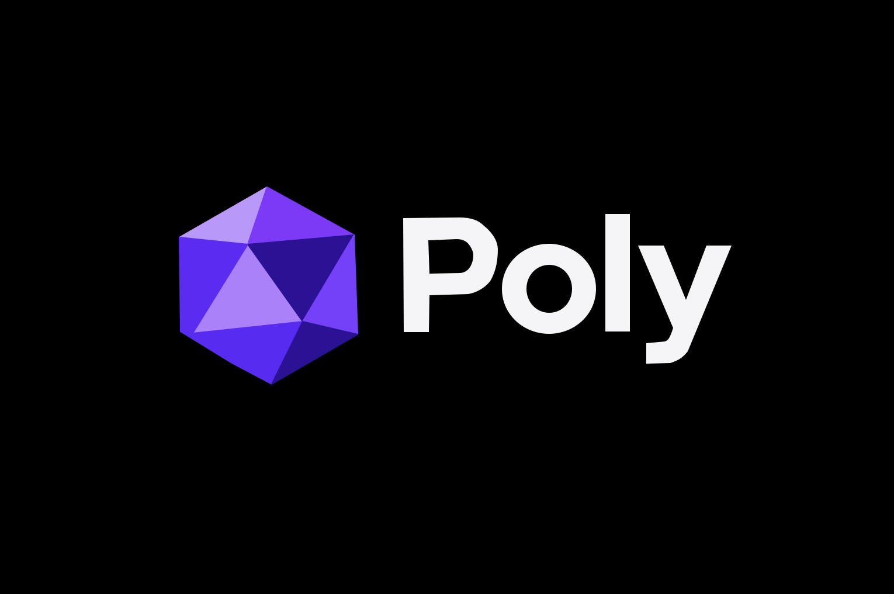

# Poly Build System and Package Manager Specification
**Version:** 0.2.1
**Ownership:** Poly is owned by AXIOM 
**Status:** Available.
**License:** MPL-2.0
**Last updated:** 2026-11-06
---

## 1. Overview

Poly is one build system and package manager for Rust, C/C++ and Go. A project has one manifest (`poly.ini`), one lock file (`poly.lock`) and one command set, no matter how many of those languages it uses.

Poly is not a wrapper. It calls the compilers itself:

- **Rust:** `rustc` directly. No Cargo.
- **C/C++:** `gcc`, `clang` or `msvc` directly. No CMake, Make, Meson or Autotools.
- **Go:** `go tool compile` and `go tool link` directly for pure-Go packages. Module-aware operations (cgo builds, `poly test`, `poly lint`) delegate to the `go` command - poly does not implement a Go module/build system.

Poly does its own dependency resolution, build graph construction, incremental compilation and linking.

Each package is a single VFSX-signed archive. For each platform it contains one executable, and that executable is built from every language in the package.

---

## 2. Goals and Principles

1. **Native, not a wrapper.** Poly drives the compilers itself.
2. **Minimal configuration.** One INI file, easy to read, edit and parse.
3. **Signed by default.** Every package is a VFSX archive and is verified before it is extracted.
4. **One artifact per platform.** A package ships as one archive containing one executable per platform.
5. **Unix-y.** Familiar commands, fast, and composable with other tools.

---

## 3. Background

Modern projects often mix languages. Each one has its own toolchain:

| Language | Traditional tooling |
|----------|---------------------|
| Rust | Cargo |
| C/C++ | CMake, Make, Meson, Autotools |
| Go | Go modules |

This causes three problems: no unified dependency resolution, separate lock files, and inconsistent build tooling. Poly provides one toolchain for all three.

---

## 4. Architecture

```
poly/
├── Cargo.toml              ← Poly's own source build (not used by Poly projects)
├── crates/
│   ├── poly-core/          ← Task graph, caching, execution
│   ├── poly-resolver/      ← Dependency resolution (SAT solver)
│   ├── poly-registry/      ← Registry client (VFSX-verified)
│   ├── poly-rust/          ← Rust driver (rustc)
│   ├── poly-c/             ← C/C++ driver (gcc, clang, msvc)
│   ├── poly-go/            ← Go driver (go tool)
│   ├── poly-linker/        ← Links one executable from several languages
│   ├── poly-package/       ← Single-binary packaging
│   ├── poly-vfsx/          ← VFSX signing and verification
│   ├── poly-test/          ← Test runner
│   ├── poly-lint/          ← Linting and formatting
│   ├── poly-doc/           ← Documentation generation
│   ├── poly-ci/            ← CI configuration generator
│   ├── poly-toolchain/     ← Toolchain management
│   ├── poly-cross/         ← Cross-compilation
│   ├── poly-sbom/          ← SBOM generation
│   ├── poly-audit/         ← Advisory checks
│   ├── poly-plugin/        ← Plugin system
│   ├── poly-migrate/       ← Migration from other tools
│   └── poly-cache/         ← Build cache (local and remote)
```

---

## 5. Configuration: poly.ini

### 5.1 Example

```ini
[project]
name = my-app
version = 1.0.0
edition = 2024

[workspace]
members = lib, bin, cli
sharedDeps = serde, tokio

[target.lib]
language = rust
type = lib
sources = src/lib.rs
edition = 2024
features = serde

[target.crypto]
language = c
type = static-lib
sources = src/crypto/*.c, src/crypto/*.h
compiler = clang
flags = -O3, -Wall

[target.server]
language = go
type = bin
sources = cmd/server/*.go
module = github.com/user/my-app/server
cgo = true

[dependencies.rust]
serde = 1.0
tokio = 1.0|full

[dependencies.c]
openssl = 3.0|poly
libz = 1.2|system

[dependencies.go]
github.com/gorilla/mux = 1.8
github.com/lib/pq = 1.10

[build.default]
targets = rust:lib, c:crypto, go:server

[build.profiles.debug]
rust.flags =
c.flags = -g
go.flags =

[build.profiles.release]
rust.flags = --release
c.flags = -O3
go.flags = -ldflags, -s -w

[publish]
targets = rust:lib, c:crypto, go:server
platforms = x86_64-linux, aarch64-macos, x86_64-windows
includeDocs = true
crateName = my-org-my-app        # optional crates.io name override
tokenEnv = MY_REGISTRY_TOKEN     # optional env var for custom registry auth
# registry = https://registry.example.com   # optional custom Poly registry

[vfsx]
sign = true
keyfile = ~/.poly/private.pem
verify = true
trustStore = ~/.poly/trust/

[format]
rust = rustfmt
c = clang-format
go = gofmt

[cache]
local = ~/.poly/cache
remote = https://cache.crates.io
enabled = true

[toolchain.rust]
version = 1.82.0
channel = stable

[toolchain.c]
compiler = clang
version = 18

[toolchain.go]
version = 1.22.0

[cross]
targets = aarch64-linux, x86_64-windows
sysroot = /usr/aarch64-linux-gnu

[plugins]
myPlugin = path:./plugins/my-plugin

[hooks.preBuild]
command = ./scripts/pre-build.sh

[hooks.postTest]
command = ./scripts/notify.sh

[secrets]
apiKey = env:API_KEY
dbPassword = vault:secret/db/password
```

### 5.2 Conventions

1. **Dots make hierarchy.** `[target.lib]` is target `lib`. `[build.profiles.release]` is nested.
2. **Commas make arrays.** `members = lib, bin` and `flags = -O3, -Wall`.
3. **Pipes add metadata to a value.** `tokio = 1.0|full` means version 1.0 with the `full` features. `openssl = 3.0|poly` means version 3.0 from the Poly registry.
4. **Keys are camelCase.** `trustStore`, `includeDocs`, `runOnBuild`. Single-word keys like `sysroot` are unchanged.

### 5.3 Naming Rules

- Every config key must be camelCase: it starts with a lowercase letter and has no hyphens, underscores or dots (dots are only used for sections, as in convention 1).
- Section names are lowercase, with dots for hierarchy. Hyphens and underscores are not allowed in section names. `[hooks.preBuild]`, not `[hooks.pre-build]`.
- Dependency names are exempt. They are the names of external packages (`serde`, `github.com/gorilla/mux`) and are kept as published.
- Values are not checked.

**Poly warns on non-camelCase keys.** When `poly.ini` is parsed, any key that is not camelCase produces a warning that names the key and the expected form:

```
warning: poly.ini:14: key 'trust_store' is not camelCase, use 'trustStore'
```

Warnings do not stop the build. Poly reports them on every command that reads `poly.ini`, including `poly build`, `poly lint` and `poly ci`.

**Poly suppresses Rust's naming warnings.** Rust warns about camelCase function and variable names through the `non_snake_case` lint. When Poly invokes `rustc` for any Rust target, it passes `-A non_snake_case` so camelCase identifiers in Rust code build without warnings. Poly applies this only to the `non_snake_case` lint. Other Rust warnings are unchanged.

Go and C/C++ have no equivalent default warning, so no suppression is needed there.

---

## 6. Dependencies and the Lock File

### 6.1 Sources

- `poly`: the Poly registry (VFSX-signed)
- `system`: a system package found through pkg-config
- `git`: a Git repository, with optional `|branch=`, `|tag=` or `|rev=` pinning
- `path`: a local path

### 6.2 poly.lock

One lock file covers all three languages. Each entry records a version, a checksum and a signature.

The checksum scheme follows the source: `sha256:` for crates.io and proxy.golang.org (registry-mandated), `blake3:` for Poly-registry packages (vfsx archives are blake3 content-addressed), and no checksum for local sources (`system`, `git:`, `path:`). `signature = vfsx:…` is recorded once the archive is verified.

```ini
[lock]
version = 1
generated = 2026-11-02T18:00:00Z

[dependency.rust.serde]
version = 1.0.203
checksum = sha256:abc123...
source = https://crates.io
signature = vfsx:xyz789...

[dependency.c.openssl]
version = 3.0.13
checksum = sha256:def456...
source = crates.io
signature = vfsx:uvw101...
```

### 6.3 Commands

```bash
poly add rust:serde
poly add c:openssl
poly remove go:github.com/lib/pq
poly update                 # all dependencies
poly update rust:tokio      # one dependency
poly outdated
poly tree
poly lock
```

---

## 7. Build System

### 7.1 Rust (direct rustc)

- Explicit `rustc` invocations with flags Poly controls
- Crate graph built by parsing sources directly
- Feature resolution and `cfg` evaluation handled by Poly
- Incremental compilation through Poly's own dependency tracking
- `non_snake_case` is suppressed on every Rust compile, so camelCase identifiers build cleanly (see section 5.3)
- Build scripts run through `rustc --run` in place of `build.rs`
- Target triples for cross-compilation
- Panic strategy and LTO configuration

### 7.2 C/C++ (direct compiler)

- Compiler detection for `gcc`, `clang` and `msvc`, including version detection
- Build graph from the source lists or globs in `poly.ini`
- Header dependency scanning (`gcc -MMD`, `clang -M`, or Poly's own scanner), so header changes trigger rebuilds
- Cross-compilation through sysroots, toolchains and flags
- Static or dynamic linking
- Library search path management
- pkg-config for system dependencies only, not as a build system
- Preprocessor flags, optimization and debug symbols

### 7.3 Go (direct go tool)

- Pure-Go packages compile through `go tool compile` and `go tool link` invoked directly - no `go build`, no `go.mod`. Poly generates the `importcfg` itself.
- Dependency export data (`.a` files for stdlib and imports) is resolved with `go list -export -deps`, which compiles packages on demand. Poly does not reimplement Go's package loader or builder; this is the one place the `go` command participates in a pure-Go build.
- CGO packages, `poly test`, and `poly lint` for Go delegate to the `go` command (`go build`, `go test`, `go vet`): cgo file generation and testmain synthesis have no `go tool`-level equivalent.
- `go.mod`/`go.sum` are not read. Go target dependencies declared in `poly.ini` are not yet wired into the resolver (currently empty); module-mode operations fall back to the `go` command's own resolution.
- Vendoring
- GOPATH and module modes
- CGO, so C dependencies can be called from Go
- Build tags and constraints
- Go workspaces

### 7.4 Commands

```bash
poly build                          # all default targets, all platforms
poly build --target rust:lib        # one target
poly build --release                # release profile
poly clean
```

**Build output.** Poly writes build artifacts to `dist/{profile}/` instead of `target/`. The `{profile}` is `debug` or `release` based on the `--release` flag. Compiled dependency artifacts live outside `dist/` in the project cache (`~/.cache/poly/{project}/{profile}/deps/`) so `dist/` only ever holds deliverables.

After a successful packaged build, `dist/{profile}/` is removed - the merged archive is the only thing left:

```
dist/
└── {name}-{version}-{profile}.vfsx.tar.zst   ← combined package
```

`poly build --no-package` keeps the per-profile tree (`bin/` executables + per-platform VFSX archives) for inspection.

**Cross-compilation.** Poly compiles for both Windows and Linux by default. There is no `--target` flag to choose an OS; Poly always produces binaries for both platforms. For Rust, this uses `--target x86_64-unknown-linux-gnu` and `--target x86_64-pc-windows-gnu`. For Go, it sets `GOOS=linux` and `GOOS=windows`. For C/C++, it uses the appropriate compiler or cross-compiler.

**VFSX packaging.** After building, Poly packages the compiled binaries as VFSX archives using the external `vfsx` command (`vfsx create <dir> -o <out> -c zstd`). Each platform gets its own archive containing all binaries for that platform, named `{project}-{platform}.{profile}.vfsx.tar.zst`. These per-platform archives are intermediates: the final step merges them into the combined `{name}-{version}-{profile}.vfsx.tar.zst` package at the `dist/` root.

---

## 8. Packages and Signing

### 8.1 Package format

A package is one VFSX archive, for example `my-app-1.0.0-release.vfsx.tar.zst`. It is signed as a whole.

```
my-app-1.0.0-release.vfsx.tar.zst   (VFSX-signed)
├── vfsx.manifest.json             ← Metadata and signatures
├── src/                           ← Source code
├── poly.lock                      ← Dependency lock file
└── bin/                           ← Prebuilt executables, one per platform
    ├── x86_64-linux/my-app
    ├── aarch64-macos/my-app
    └── x86_64-windows/my-app.exe
```

Each platform directory holds one executable. That executable contains the code for every language the package targets (Rust, C/C++ and Go, where used). There are no per-language binaries in a package.

### 8.2 Single-binary packaging

Each target produced for a platform is linked into one executable by `poly-linker`. The single-executable packaging reuses code from Jiggle, which already builds native languages and links them into one output.

Poly applies the same packaging rules everywhere: a package holds one executable per platform, and running it needs only that executable.

### 8.3 Signing

- Packages are VFSX archives
- Packages are verified before they are extracted
- Sources are trust-pinned

```bash
poly sign                       # sign the current project
poly verify                     # verify all signatures
poly trust add axiomwtf         # add a trusted signer
poly trust list
poly trust remove <key>
```

---

## 9. Packaging

Every `poly build` produces the combined package `dist/{name}-{version}-{profile}.vfsx.tar.zst` (containing `package.json`, `poly.lock`, and one executable per platform under `bin/<platform>/`). After the archive is written, `dist/{profile}/` is removed so `dist/` holds only the package. `poly build --no-package` skips packaging and keeps the build tree.

`[publish]` in `poly.ini` sets package metadata: `platforms` selects which platform executables are included, `include_docs = true` bundles sources, and `crateName` controls crates.io naming recorded in `package.json` dependencies.

`poly login`/`poly logout` manage registry API tokens in `~/.config/poly/credentials.toml` (`0600`); token resolution order: `CARGO_REGISTRY_TOKEN` env → Poly credentials → `~/.cargo/credentials.toml`.

`poly uninstall <package>` removes an installed package. Installers (deb, rpm, msi) can be generated from the same package.

---

## 10. Quality Tooling

### 10.1 Testing

```bash
poly test                       # all tests
poly test --coverage
poly test --benchmark
poly test rust:lib              # one language or target
```

Tests are found across all languages and reported in one format.

### 10.2 Linting and formatting

```bash
poly lint                       # all linters
poly lint rust:lib              # one target
poly fmt                        # format everything
```

Linting can run on every build and can gate CI. Pre-commit hooks are supported.

**Poly lints Rust sources natively.** `poly lint` does not invoke rustc or clippy for naming checks. Poly scans each Rust target's own `sources` directly - declarations (`fn`, `struct`, `enum`, `trait`, `union`, `type`, `const`, `static`, `mod`), `let`/`for` bindings, `macro_rules!` names, function parameters, and struct fields - and warns on every identifier that is not camelCase per section 5.3:

```
crates/poly/src/migrate.rs:555: warning: identifier `pkg_name` is not camelCase
```

Only the project's own sources are scanned. Dependency crates and registry packages are never linted, and no compiler or linter toolchain is required for the naming pass.

**Other languages keep their toolchains.** C/C++ targets lint through `clang --analyze` (or `gcc -fsyntax-only -Wall -Wextra` as fallback). Go targets lint through `go vet`. Neither runs a camelCase pass - Go's own naming style already matches section 5.3.

Config keys in `poly.ini` are never read by the linters, so they are unaffected too.

### 10.3 Documentation

```bash
poly doc
poly doc --open
poly doc --serve
```

Docs are generated for every language. API references are extracted from the source. Docs can be hosted on crates.io.

### 10.4 Versioning and releases

```bash
poly version bump minor
poly version check              # detect breaking changes
poly version generate-changelog
poly release                    # build release and package
poly release --dry-run
```

Release notes can be generated for GitHub releases.

### 10.5 Security and compliance

```bash
poly audit                      # check for known vulnerabilities
poly audit fix
poly sbom                       # SBOM (SPDX or CycloneDX)
poly sbom --verify              # check against poly.lock
poly review                     # review new dependencies
poly review --strict
poly diff                       # show dependency changes
```

SBOM output covers vulnerabilities and license compliance.

---

## 11. Toolchains and Cross-Compilation

### 11.1 Toolchains

```bash
poly toolchain install rust:1.82.0
poly toolchain use rust:nightly
poly toolchain list
```

Multiple Rust, Go and compiler versions can be installed. Each project can pin its own.

### 11.2 Cross-compilation

Poly compiles for both Windows and Linux by default on every build. There is no option to choose a single OS; `poly build` always produces binaries for both platforms.

For each platform, Poly:
- **Rust:** invokes `rustc --target x86_64-unknown-linux-gnu` or `--target x86_64-pc-windows-gnu`
- **C/C++:** uses the platform-appropriate compiler or cross-compiler
- **Go:** sets `GOOS=linux` or `GOOS=windows` (and `GOARCH=amd64`)

After compiling, Poly packages each platform's binaries into a separate VFSX archive in `dist/{profile}/`. The archives are named `{project}-{platform}.{profile}.vfsx.tar.zst` (zstd-compressed VFSX archives produced by the external `vfsx` tool).

Advanced cross-compilation to other platforms (aarch64, macOS, etc.) can be configured in `[cross]` for future phases.

---

## 12. Developer Tools

```bash
poly completion bash            # also zsh, fish
poly ide vscode                 # generate VS Code config
poly ide neovim                 # generate Neovim config
poly ide lsp                    # start LSP server
poly profile                    # profile a build
poly flamegraph
poly debug rust:lib
poly stats                      # package download stats
```

The LSP server supports jump-to-definition across languages.

---

## 13. Extended Features

### 13.1 Workspaces

```ini
[workspace]
members = lib, bin, cli
shared_deps = serde, tokio
```

Members share dependency versions, can depend on each other by local path, and share tests and lints.

### 13.2 Git dependencies

```ini
[dependencies.rust]
my-lib = git:https://github.com/user/my-lib|branch=main
```

### 13.3 Build cache

Local and remote caches. Remote caches can be shared across machines.

```bash
poly cache stats
poly build --verbose            # show what is being rebuilt
```

### 13.4 Hooks and plugins

Hooks run scripts before or after a build or test. Plugins add custom build steps, and community plugins are supported.

### 13.5 CI generation

```bash
poly ci github
poly ci gitlab
poly ci docker
```

Generated configs use the cache settings from `poly.ini`. Docker output uses multi-stage builds.

### 13.6 Migration

```bash
poly migrate cargo              # Cargo.toml → poly.ini
poly migrate go-mod             # go.mod → poly.ini
poly migrate cmake              # CMakeLists.txt → poly.ini
```

Migration keeps existing metadata and writes a report.

### 13.7 Secrets

Secrets can come from environment variables (`env:`) or Vault (`vault:`), and are injected at build time.

### 13.8 Virtual environments

```bash
poly env create my-env
poly env activate my-env
poly env deactivate
```

Environments are sandboxed for reproducible builds.

---

## 14. Registry (crates.io)

- Search and discovery
- Package analytics and download counts
- Private registries for teams
- Hosted documentation
- Remote build cache

---

## 15. CLI Reference

```bash
# Core
poly init
poly build [--target <id>] [--release] [--no-package]
poly test
poly clean

# Dependencies
poly add <lang>:<dep>
poly remove <lang>:<dep>
poly update [<lang>:<dep>]
poly outdated
poly tree
poly lock

# Signing and trust
poly sign
poly verify
poly trust add|list|remove <key>
poly login [registry] [--token <t>]
poly logout [registry]

# Quality
poly lint
poly fmt
poly doc
poly test --coverage|--benchmark

# Toolchains
poly toolchain install|use|list <spec>

# Packages
poly uninstall <package>

# Security
poly audit [fix]
poly sbom [--format spdx] [--verify]
poly review [--strict]
poly diff

# CI and migration
poly ci github|gitlab|docker
poly migrate cargo|go-mod|cmake

# Other
poly completion bash|zsh|fish
poly version bump <level>
poly release [--dry-run]
poly profile
poly flamegraph
poly cache stats
poly env create|activate|deactivate <name>
poly stats
poly ide vscode|neovim|lsp
```

---

## 16. Open Questions

- **Go runtime and CGO.** Jiggle's linking covers the native languages, Go included.
- **Executable format per platform.** Whether every platform executable is a native binary, and how embedded data is laid out, is not decided.

---

## 17. Implementation Phases

### Phase 1: Core (MVP)
- `poly.ini` parser
- `poly.lock` generation
- Dependency resolver (SAT solver)
- Basic drivers for rustc, gcc and go
- Simple task graph execution
- Basic cache

### Phase 2: Language support
- Full Rust driver (features, cfg, build scripts)
- Full C/C++ driver (header scanning, linking)
- Full Go driver (modules, CGO)
- Unified linker orchestration

### Phase 3: Integrations and packaging
- VFSX signing and verification
- Package registry client
- Single-binary packaging: one executable per platform inside each package archive

### Phase 4: Developer experience
- Test runner
- Linting and formatting
- Documentation generation
- Shell completion
- IDE integration

### Phase 5: Advanced features
- Toolchain management
- Cross-compilation
- CI/CD generation
- Migration tools
- Plugin system

### Phase 6: Registry and ecosystem
- crates.io registry
- Package analytics
- Private registries
- Binary installation and distribution

---

## 18. Future Extensions

**Features:** distributed build coordination, remote build execution, WebAssembly output, GPU compute integration.

---

## 19. Comparison

| Feature | Poly | Cargo | CMake | go mod |
|---------|------|-------|-------|--------|
| Multiple languages | ✅ | ❌ | ❌ | ❌ |
| Unified lock file across languages | ✅ | ❌ | ❌ | ❌ |
| Direct compiler invocation | ✅ | ❌ (via rustc, managed by Cargo) | ❌ (via gcc/clang) | ❌ (via go tool) |
| One executable per platform, all languages | ✅ | ❌ | ❌ | ❌ |
| VFSX signing | ✅ | ❌ | ❌ | ❌ |
| Workspace support | ✅ | ✅ | ❌ | ✅ |
| Git dependencies | ✅ | ✅ | ❌ | ✅ |
| Cross-compilation | ✅ | ✅ | ✅ | ✅ |
| Config format | INI | TOML | CMake language | go.mod |
| Plugin system | ✅ | ❌ | ❌ | ❌ |
| Replaces | Cargo, CMake, Make, go build (pure-Go) | - | - | - |

---

## 20. License

MPL-2.0. Source changes must be disclosed, the license must be included, and modifications use the same license.

---

## 21. Resources

- Axiom: https://github.com/axiomwtf
- VFSX: https://github.com/axiomwtf/vfsx
- Poly is an Axiom project. Contributions are welcome.

---

*End of Specification*
